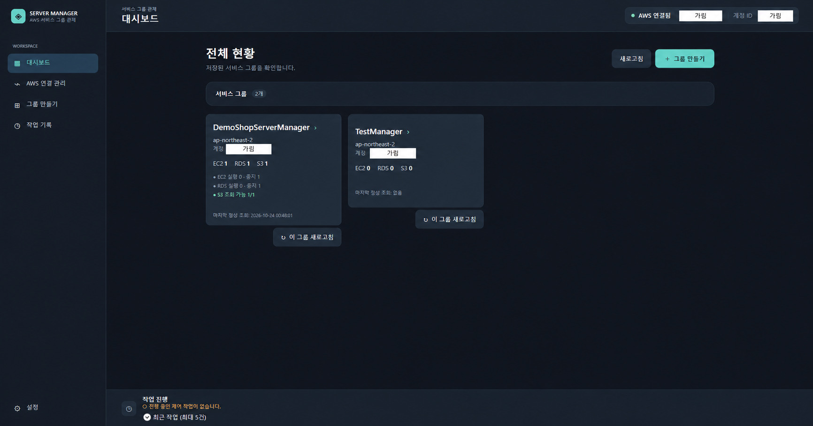
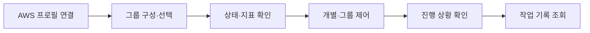
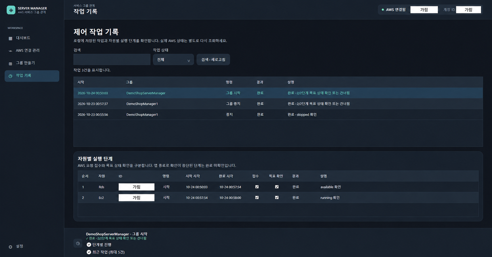

# PersonalServerManager


AWS의 서버와 DB를 서비스별로 묶어 상태를 확인하고, 정해 둔 순서로 시작·중지하는 Windows 데스크톱 앱입니다.

스크린샷의 AWS 계정 ID, 프로필명, 리소스 이름·ID는 흰색 박스로 가렸습니다.

## 개발 계기와 방향

개인 서비스를 운영하면서 AWS 콘솔에 로그인해 EC2, RDS, S3 화면을 오가며 상태를 확인하고 제어하는 과정이 번거로웠습니다. 서버 하나를 관리할 때도 불편한데, 두세 개로 늘어나면 관리가 더 복잡해질 것 같았습니다. 자주 쓰는 기능을 한곳에 모아 제가 편하게 사용할 도구를 만들고자 했습니다.

핵심 기능은 **AWS 연결 → 서버·DB 그룹화 → 그룹 시작·중지 → 모니터링**으로 정했습니다. 개별 자원 목록보다 같은 서비스에 쓰이는 자원을 함께 다루는 흐름에 집중했습니다. 이미 만들어진 AWS 자원을 관리하는 범위로 시작했고, 자원 생성·삭제와 배포는 제외했습니다.

C#·데스크톱 개발 경험을 쌓으려는 목적도 있어 WPF를 선택했습니다. 제가 사용하는 Windows PC에서 실행할 도구였고, 필요한 화면과 기능을 구현하기에 충분하며 개발 부담도 적다고 판단했습니다.


## 기능을 정하며 고려한 점

### 인증 정보는 앱에 따로 저장하지 않기

초기 개발에서는 보안을 고려해 액세스 키를 앱에서 직접 입력받고 저장하는 대신, PC에 등록된 AWS CLI 공유 프로필을 선택하는 방식을 택했습니다. 키가 소스코드나 앱 설정에 포함돼 유출될 위험을 줄이기 위해 AWS SDK가 선택한 프로필의 자격 증명을 읽어 연결하고, 앱 설정에는 프로필 이름만 저장하도록 결정했습니다.

### 서버보다 DB를 먼저 준비

EC2의 서버가 먼저 켜져 사용자가 접속했는데 DB가 아직 준비되지 않았다면 문제가 생길 수 있다고 생각했습니다. 이를 줄이기 위해 RDS를 먼저 시작하고 준비 상태를 확인한 뒤 EC2를 시작하는 순서를 설정할 수 있도록 했습니다. 그룹 중지는 시작 순서의 역순으로 진행합니다.

시작 명령을 보낸 것과 실제 준비가 끝난 것은 구분했습니다. 각 자원이 목표 상태에 도달해야 다음 단계로 넘어가고, 실패하거나 시간이 초과되면 후속 작업을 멈춥니다. S3는 시작·중지 대상에 넣지 않고 조회와 모니터링만 제공합니다.

### 그룹의 상태를 한눈에 확인

제어와 함께 모니터링도 처음부터 핵심 기능으로 정했습니다. 그룹에 등록한 자원의 CloudWatch 지표를 그래프 카드로 모아 보고, 그리드와 스택 배치를 선택할 수 있도록 했습니다.

화면은 직접 실행하며 확인했습니다. 표의 글자가 잘리거나 색상 대비가 낮은 부분은 캡처와 함께 수정 요청을 전달했습니다. 그래프 화면 재진입 시 앱이 종료되는 문제도 재현 상황을 바탕으로 에이전트가 원인을 확인하고 수정했습니다.

## 기술과 구조

| 기술 | 사용한 곳 |
|---|---|
| C# · .NET 10 · WPF | Windows 앱과 XAML 화면 |
| MVVM | 화면 표시, 상태·명령, 서비스 로직 분리 |
| AWS SDK for .NET | 프로필 인증과 AWS 자원 조회·제어 |
| OxyPlot.Wpf | CloudWatch 지표 그래프 |
| JSON | 그룹 구성과 앱 설정 저장 |
| Microsoft.Data.Sqlite | 작업 기록 저장과 검색 |

```text
View → ViewModel → Service → AWS / 로컬 저장소
```

공통 색상과 컨트롤 스타일은 `ResourceDictionary`에서 관리합니다. 그룹 구성과 설정은 JSON에, 계속 쌓이고 검색해야 하는 작업 기록은 SQLite에 저장합니다. AWS 인증은 PC에 등록된 프로필을 사용하며 비밀 키는 앱 설정에 저장하지 않습니다.

## 주요 기능과 사용 흐름



1. **AWS 연결:** PC에 등록된 프로필을 선택해 연결합니다. 연결한 계정과 그룹의 계정이 일치할 때만 조회·제어할 수 있습니다.
2. **그룹 구성:** EC2·RDS·S3를 선택하고 EC2/RDS 시작 순서를 저장합니다. 이름, 연결 자원, 순서를 편집할 수 있습니다.
3. **상태 확인:** 대시보드와 그룹 상세에서 자원 상태와 CloudWatch 지표를 확인합니다. 선택적으로 HTTP Health Check를 설정할 수 있으며 실제 서비스 URL 적용은 보류 중입니다.
4. **제어:** EC2 개별 시작·중지·재부팅, 지원되는 RDS 시작·중지, 그룹 순차 시작·역순 중지를 실행합니다. 화면을 이동해도 하단에서 진행 상황을 확인할 수 있습니다.
5. **기록 조회:** 작업 결과와 자원별 실행 단계를 저장하고 검색합니다.

### 그룹 제어와 진행 상황

그룹 상세에서 등록한 자원을 확인하고 시작·중지를 실행합니다. 아래 화면은 RDS의 준비 상태를 기다리는 단계로, EC2는 아직 명령을 보내기 전입니다. 하단에서 현재 단계와 남은 작업을 확인할 수 있습니다.


### 그룹 모니터링

그룹에 등록된 자원의 CloudWatch 지표를 카드별로 확인합니다. 아래는 EC2의 CPU 사용률, 송수신 트래픽, 상태 검사를 2열 그리드로 표시한 화면 일부입니다. 시간 범위와 그리드·스택 배치를 선택하고, 최신 측정값과 AWS 측정 시각을 함께 확인할 수 있습니다.


### 작업 기록과 단계별 결과

작업 기록에서 실행 결과를 검색하고, 자원별 요청 접수와 목표 상태 확인을 구분해 볼 수 있습니다. 아래 화면에는 RDS 다음 EC2 순서로 진행한 그룹 시작 작업의 완료 결과가 표시됩니다.



## 추후 확장 계획

- 앱 안에서 서버 로그를 조회하고 검색하는 기능
- 더 다양한 인증 방식과 AWS 서비스 지원
- 서비스 내부 애플리케이션 관리와 상태 점검 확대
- 모니터링 정보와 그룹 제어 방식 확장

상세한 결정과 설계는 [요구사항](doc/REQUIREMENTS.md), [기술 설계](doc/ARCHITECTURE.md), [개발 계획](doc/DEVELOPMENT_PLAN.md), [UI 설계](doc/UI_DESIGN.md)에 정리했습니다. 구현·검증 상태는 [개발 진행 현황](doc/PROGRESS.md)에서 확인할 수 있습니다.
