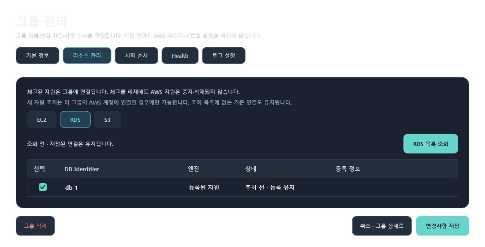
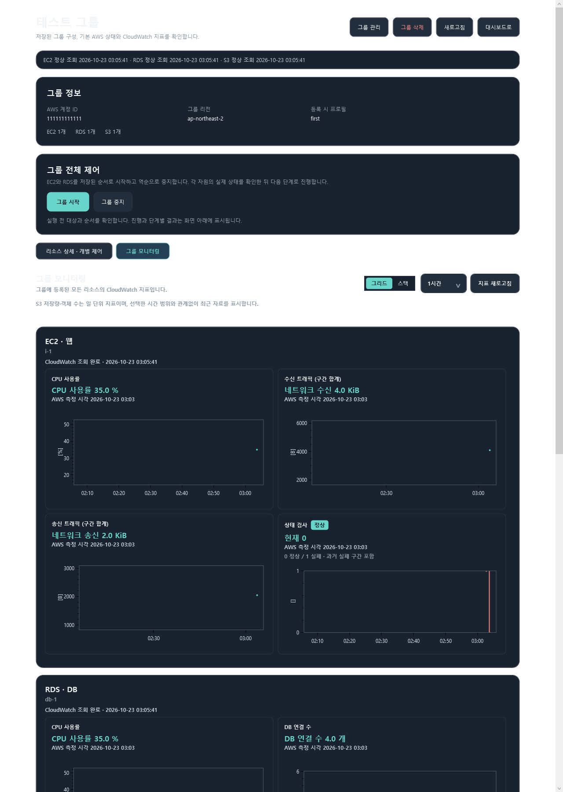

# PersonalServerManager

AWS 리소스를 서비스 단위로 묶어 상태를 확인하고, EC2·RDS를 정해 둔 순서로 제어하는 Windows 데스크톱 앱입니다. 여러 AWS 콘솔 화면을 오가며 서버·DB의 순서와 실행 결과를 수동으로 추적하던 문제를 줄이는 것을 목표로 만들었습니다.

그룹 시작은 저장한 EC2/RDS 순서대로, 중지는 역순으로 실행합니다. 각 자원이 목표 상태에 도달했는지 확인한 뒤 다음 명령을 보냅니다. S3는 조회·모니터링만 제공하며 제어하지 않습니다.

## 주요 기능

| 영역 | 구현 내용 |
|---|---|
| AWS 연결 | 로컬 AWS 공유 프로필 선택, STS로 계정 확인, 재연결 안내. 앱 시작 시 자동 연결하지 않음 |
| 그룹 관리 | EC2·RDS·S3 리소스 등록, 중복 연결 방지, 이름·연결 자원·시작 순서 편집, 로컬 그룹 삭제 |
| 제어 | 개별 EC2 시작·중지·재부팅, 지원되는 RDS 시작·중지, 그룹 순차 시작·역순 중지, 명령 전 확인, 중복 실행 차단, 목표 상태 대기·시간 초과·남은 단계 취소 |
| 모니터링 | CloudWatch 지표 EC2 4종·RDS 6종·S3 2종, 그리드 2열/스택 1열, 상태 검사 정상·실패·데이터 없음 구분 |
| 애플리케이션 상태 | EC2별 선택적 HTTP Health URL과 판정 규칙, 30초 자동 점검, 수동 점검 및 최근 10회 결과 |
| 작업 기록 | SQLite에 작업·자원별 단계와 AWS 요청 접수/목표 확인을 구분해 저장, 검색·상태 필터·보존 기간 설정, 기록 오류 시 새 제어 차단 |

## 화면 예시

아래 이미지는 **가짜 AWS 응답으로 WPF 화면을 렌더링한 예시**입니다. 실제 리소스 화면이나 실환경 검증 증거로 사용하지 않습니다.





## 사용 흐름

1. **AWS 연결 관리**에서 PC에 등록된 프로필을 선택하고 명시적으로 연결합니다. STS 응답의 계정 ID와 그룹에 저장된 계정 ID가 달라지면 해당 그룹의 AWS 조회·제어를 차단합니다.
2. **그룹 만들기**에서 리전과 리소스를 선택하고 EC2/RDS 시작 순서를 저장합니다. 그룹 구성은 앱 재실행 후에도 복원됩니다.
3. **대시보드·그룹 상세**에서 기본 상태, CloudWatch 지표와 선택적 Health 결과를 확인합니다.
4. 제어할 때는 대상과 영향을 확인한 후 실행합니다. 앱은 AWS 요청 접수와 목표 상태 확인을 별도 단계로 표시합니다. 실패·시간 초과 시 후속 명령을 보내지 않으며 자동 롤백하지 않습니다.
5. **작업 기록**에서 결과와 자원별 단계를 조회합니다. 기록은 과거 실행 사실을 보여주므로 현재 AWS 상태는 다시 조회해야 합니다.

## 설계와 저장

`net10.0-windows` WPF 앱이며 XAML·MVVM을 사용합니다. View는 표시, ViewModel은 화면 상태와 명령, Service는 그룹 규칙·AWS 호출·저장을 담당합니다. `App.xaml.cs`에서 의존 객체를 명시적으로 조립하고, 외부 경계는 테스트용 가짜 구현으로 교체할 수 있게 했습니다. AWS SDK for .NET, OxyPlot.Wpf, Microsoft.Data.Sqlite를 사용합니다.

```text
Views / ViewModels
        ↓
Services/Groups ── Services/Aws ── AWS SDK
        └────────── Services/Persistence ── JSON / SQLite
```

- `%LocalAppData%\PersonalServerManager\settings.json`: 선택 프로필 이름, 그룹·Health 구성, 제한시간·보존 기간. AWS 비밀 키나 활성 인증 세션은 저장하지 않습니다. 파일이 손상되면 자동 초기화·덮어쓰기 없이 오류를 알립니다.
- `%LocalAppData%\PersonalServerManager\control-history.db`: 제어 작업과 자원별 실행 단계. 진행 중 앱이 종료되면 재시작 시 완료 미확인으로 표시하고 자동 재실행하지 않습니다.
- 프로필 자격 증명은 사용자의 AWS 공유 설정 파일에서 읽습니다. 그룹 정보와 제어 이력은 사용자별 로컬 저장소에 둡니다.

## 로컬 실행과 검증

Windows와 .NET 10 SDK가 필요합니다. 실제 AWS 기능을 사용할 때는 앱에서 지원하는 로컬 AWS 공유 프로필과 필요한 STS·EC2·RDS·S3·CloudWatch 권한을 준비해야 합니다. AWS 프로필을 만들거나 서버에 Health API를 설치하는 기능은 앱에 없습니다.

```powershell
dotnet build PersonalServerManager.slnx
dotnet run --project PersonalServerManager/PersonalServerManager.csproj
dotnet run --project PersonalServerManager.SmokeTests/PersonalServerManager.SmokeTests.csproj
```

2026-10-23 기준 앱 빌드와 로컬/Mock 스모크 **28건**이 통과했습니다. 통합 스모크는 임시 JSON·SQLite와 가짜 AWS/HTTP 응답으로 `그룹 등록 → 상태 조회 → 그룹 순차 시작 → 단계 기록 → 지표·Health 조회 → 재시작 후 복원`을 확인합니다. 실제 AWS 명령은 이 테스트에서 보내지 않습니다. 스모크 실행 환경에 따라 NuGet 취약성 정보 서버 접속 실패 경고 `NU1900`이 나타날 수 있습니다.

실환경에서는 사용자가 AWS 연결·리소스 조회, CloudWatch 지표 표시, 그룹 시작/역순 중지 및 일부 이력·설정 UI 동작을 확인했습니다. **개별 시작·재부팅, 제어 오류·취소의 실환경 동작, S3 지표 합계와 API 호출량은 별도 확인이 필요합니다.** Health URL의 실제 적용과 서버 코드 변경은 보류 중입니다. 검증 범위와 남은 항목은 [개발 진행 현황](doc/PROGRESS.md)에 구분해 기록했습니다.

## 남은 작업

- **CloudWatch Logs 조회·검색(FR-011): 구현 예정.** 현재 로그 설정 탭은 안내 화면입니다.
- 승인된 범위에서 남은 AWS 제어·오류 시나리오를 확인하고, Health 실제 URL을 준비하면 앱과 서버 응답을 함께 검증합니다.
- 배포용 서명·설치 방식과 Windows 앱 제어 정책 환경의 실행을 별도로 확인합니다.

설계 기준은 [요구사항](doc/REQUIREMENTS.md), [개발 계획](doc/DEVELOPMENT_PLAN.md), [UI 설계](doc/UI_DESIGN.md)에 있습니다.
