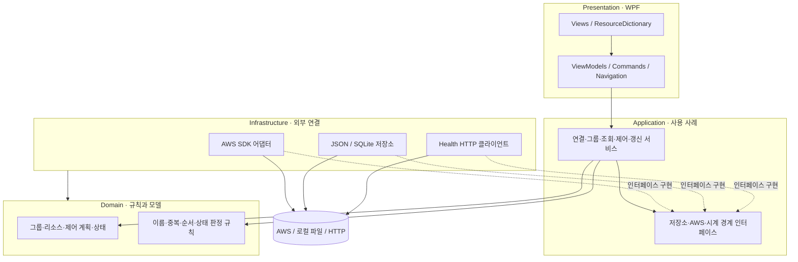

# ARCHITECTURE.md — PersonalServerManager 기술 설계

## 1. 목적, 기준, 현재 상태

이 문서는 `REQUIREMENTS.md`의 확정 요구사항, `UI_DESIGN.md`의 확정 화면 구조, `DEVELOPMENT_PLAN.md`의 단계 순서를 구현 구조로 옮긴다. 기능 범위와 우선순위는 해당 문서가 우선한다. 이 문서의 클래스명과 파일 배치는 **설계 예정 요소**이며, 구현하면서 이름을 바꿀 수 있어도 책임과 의존성 방향은 유지한다.

현재 소스에는 `net10.0-windows`, `UseWPF=true`, nullable 활성화된 단일 WPF 프로젝트와 기본 `App`, 빈 `MainWindow`만 있다. MVVM, AWS 연동, 저장소, 테스트 프로젝트, NuGet 참조는 아직 없다. 기존 `App.xaml`의 `StartupUri`는 현재 기본 창 시작 방식이다. 아래 구조가 이미 구현되어 있다는 뜻이 아니다.

Phase 1 Day 1은 연결·조회·그룹 등록·JSON·기본 대시보드, Day 2는 확인 절차·개별/순차 제어·전역 진행 상태까지다. Phase 2에서 편집, 자동 갱신 고도화, SQLite 기록 화면, CloudWatch·Health·Logs를 완성한다. Phase 1 제어 안전 규칙은 Phase 2로 미루지 않는다.

## 2. 계층과 의존성



| 계층 | 책임 | 금지할 결합 |
|---|---|---|
| Presentation | XAML 표시, 바인딩, 입력, 페이지 이동, 사용자 확인·피드백 | ViewModel의 AWS SDK 호출, JSON/SQLite 접근, 제어 순서 판단 |
| Application | 연결·그룹 등록·조회·제어·갱신 사용 사례, 작업 상태 조정, 외부 경계 인터페이스 | WPF 컨트롤 참조, AWS SDK 응답 형식을 화면 모델로 직접 노출 |
| Domain | 서비스 그룹·자원 식별·제어 계획·결과 모델과 순수 검증 규칙 | WPF, 파일, DB, SDK 의존성 |
| Infrastructure | AWS SDK, STS, HTTP, JSON, SQLite 구현과 오류 변환 | 화면 이동 또는 모달 표시 결정 |

의존성은 Presentation → Application → Domain이다. Infrastructure는 Application의 경계 인터페이스를 구현하고 Domain 모델을 사용한다. `App`의 조립 코드만 양쪽 구현체를 알고 생성한다. 단일 `.csproj` 안에서 폴더와 네임스페이스로 구분하며, 별도 프로젝트 분리는 현재 계획에 넣지 않는다.

## 3. 권장 폴더 구조

```text
PersonalServerManager/
├─ App.xaml, App.xaml.cs                 # 기존 파일; 향후 객체 조립과 시작/종료 처리
├─ MainWindow.xaml, MainWindow.xaml.cs   # 기존 파일; 향후 셸 View
├─ Presentation/
│  ├─ Views/                             # 연결, 대시보드, 생성, 상세, 관리, 기록, 설정
│  ├─ ViewModels/                        # 각 View의 상태와 명령
│  ├─ Controls/                           # 자원 선택표, 상태 표시, 진행 패널 등 공통 UI
│  ├─ Dialogs/                            # 확인 모달 View
│  ├─ Commands/                           # 비동기 ICommand 공통 구현
│  └─ Styles/                             # Colors.xaml, Controls.xaml 등 ResourceDictionary
├─ Application/
│  ├─ Services/                           # 연결, 그룹, 조회, 제어, 갱신, Health, 로그
│  ├─ Contracts/                          # AWS·저장소·시계·대화상자 경계
│  └─ Dtos/                               # 화면에 전달할 조회·작업 결과
├─ Domain/
│  ├─ Models/                             # ServiceGroup, ResourceRef, ControlPlan 등
│  └─ Rules/                              # 이름·중복·제어 순서·상태 판정
└─ Infrastructure/
   ├─ Aws/                                # 프로필, STS, EC2, RDS, S3, CloudWatch, Logs
   ├─ Persistence/                        # JSON 설정, SQLite 제어 이력
   └─ Health/                             # HttpClient 기반 점검
```

`Views`와 `ViewModels`는 화면별로 대응한다. `Domain/Models`는 저장 모델 자체가 아니라 업무 의미를 가진 모델이다. JSON/SQLite 전용 직렬화 모델은 `Infrastructure/Persistence`에 둔다. `Application/Services`는 사용 사례를 조정하고, `Infrastructure/Aws` 서비스는 개별 AWS API만 호출한다. `Repositories`라는 명칭은 영속 저장소 구현과 그 경계에만 사용한다. 인터페이스는 교체·모의 검증이 필요한 경계에 두고, 단순 내부 클래스마다 만들지 않는다.

기능이 커지면 위 폴더 안에서 `Groups`, `Control`, `Monitoring` 등 하위 폴더를 추가한다. Phase 2 요소를 Day 1에 빈 클래스와 인터페이스로 미리 생성하지 않는다.

## 4. 주요 설계 예정 요소

아래 표의 항목은 **모두 설계 예정**이다. 현재 코드에 존재하는 `App`와 `MainWindow`만 §1의 기존 요소다.

| 계층 | 클래스·인터페이스(예정) | 책임 및 생명주기 |
|---|---|---|
| Presentation | `ShellViewModel`, `NavigationService` | 현재 페이지와 사이드바, 상단 연결 상태, 하단 전역 진행 패널을 조합. 앱 수명 |
| Presentation | `DashboardViewModel`, `AwsConnectionViewModel`, `GroupWizardViewModel`, `GroupDetailViewModel` | Phase 1 화면별 입력·표시 상태와 비동기 명령. 페이지 진입마다 생성 또는 명시적 재사용 |
| Presentation | `GroupManagementViewModel`, `HistoryViewModel`, `SettingsViewModel` | Phase 2 편집 초안, SQLite 조회, 설정 화면 |
| Presentation | `IConfirmationService`, `INotificationService` | 확인 모달, 토스트, 영역별 오류 배너를 ViewModel에서 요청할 경계. WPF 구현은 Presentation에 둠 |
| Domain | `ServiceGroup`, `ResourceRef`, `StartOrder`, `ControlPlan`, `ControlStep` | 그룹 고유 ID, 계정·리전, 등록 자원, EC2/RDS 혼합 시작 순서, 실행 시 고정된 계획 |
| Domain | `GroupRules`, `ResourceIdentity` | 이름 trim/1~50자/허용 문자/대소문자 무시 중복, 계정·리전·서비스별 중복 자원 식별 |
| Application | `AwsConnectionService`, `IProfileSession` | 프로필 후보 확인 후 STS 검증, 활성 연결의 원자적 교체·해제, 계정 일치 게이트 |
| Application | `GroupService`, `ISettingsRepository` | 그룹 생성·편집 초안 검증, 중복 확인, 확정 시 전체 JSON 설정 저장, 로컬 그룹 조회 |
| Application | `ResourceQueryService`, `ResourceStatusCache` | 그룹별 EC2/RDS/S3 조회, 같은 키의 동시 요청 합치기, 정상값·오류·확인 시각 유지 |
| Application | `ControlCoordinator`, `ControlSession` | 앱 전체 제어 1건 제한, 순차 계획 실행, 취소·진행·종료 신호와 결과 공유. 앱 수명 |
| Application | `IResourceControlAdapter` | EC2/RDS 공통 `현재 상태 조회 → 명령 제출 → 목표 상태 확인` 계약. S3는 구현하지 않음 |
| Application | `RefreshCoordinator` | 기본 상태·Health·지표의 주기 작업과 화면별 구독/중단 관리. 앱 수명 |
| Application | `MonitoringService`, `HealthCheckService`, `CloudWatchLogsService` | Phase 2 지표 조회, 앱별 점검 판정, 로그 수동 조회·필터 |
| Application | `IControlHistoryRepository` | 작업/단계 이력 저장·검색·만료 정리 경계. Phase 2 도입 |
| Infrastructure | `AwsProfileProvider`, `StsIdentityGateway`, `AwsClientFactory` | 로컬 프로필 목록, `GetCallerIdentity`, 활성 자격 증명·그룹 리전별 클라이언트 생성/해제 |
| Infrastructure | `Ec2Gateway`, `RdsGateway`, `S3Gateway` | 페이지네이션 포함 서비스별 목록/상태 조회와 지원되는 명령. 제어 어댑터는 EC2/RDS만 |
| Infrastructure | `Ec2ControlAdapter`, `RdsControlAdapter` | `IResourceControlAdapter` 구현; 서비스별 명령·상태 매핑과 폴링에 필요한 상태 조회 |
| Infrastructure | `CloudWatchMetricGateway`, `CloudWatchLogsGateway`, `HealthHttpClient` | Phase 2 측정값, 로그 그룹·이벤트, 인증 없는 HTTP/HTTPS Health 조회 |
| Infrastructure | `JsonSettingsRepository`, `SqliteControlHistoryRepository` | JSON 원자적 저장·검증, SQLite 작업/단계 이력. SQLite는 Phase 2 |

`IResourceControlAdapter`는 `ResourceKind`별 구현을 명시적으로 선택한다. 각 구현은 AWS API 호출과 상태 매핑만 담당하고 시퀀스 순서·확인 모달·전역 동시 실행 정책은 `ControlCoordinator`가 담당한다. EC2 재부팅은 개별 명령으로만 취급하고 그룹 시작·중지 순서에는 넣지 않는다.

## 5. 객체 조립, 비동기 및 UI 스레드

- `App` 시작 시 설정을 먼저 읽고 검증한다. 성공하면 조립 코드에서 저장소, AWS 게이트웨이, Application 서비스, 전역 상태, 셸 ViewModel, 창을 생성한다. JSON 손상 또는 필수 값 오류면 오류 창을 보여준 후 종료한다. `StartupUri` 방식은 이를 구현할 때 코드 기반 창 생성으로 바꾸는 설계다.
- 생성자 주입을 기본으로 한다. Phase 1은 단일 프로젝트 규모에 맞는 명시적 조립 코드로 충분하다. DI 컨테이너를 쓰게 되면 등록은 `App` 한곳에 모으고 서비스 로케이터를 ViewModel에 넣지 않는다.
- 앱 수명 객체: 활성 프로필 세션, `ControlCoordinator`, `RefreshCoordinator`, 상태 캐시, 내비게이션 서비스, 설정 저장소. 화면 수명 객체: 각 페이지 ViewModel과 조회 취소 토큰. AWS 클라이언트는 활성 연결과 그룹 리전별로 필요할 때 만들고 연결 교체/종료 시 정리한다. HTTP 클라이언트는 재사용한다.
- AWS·파일·SQLite·HTTP 작업은 `Task`/`CancellationToken`을 사용하는 비동기 메서드로 실행한다. ViewModel의 비동기 명령은 실행 중 중복 클릭을 막고 예외를 결과 상태로 변환한다. 동기 대기(`.Result`, `.Wait()`)와 UI 스레드의 장시간 작업을 피한다.
- 서비스 계층은 WPF 타입을 모르며, ViewModel은 바인딩 상태 변경을 UI 스레드에서 한다. 백그라운드 진행 보고는 `IProgress<T>` 또는 셸에 전달되는 작업 상태를 거쳐 UI 디스패처에서 반영한다. 컬렉션 갱신 역시 UI 스레드에서 수행한다.
- 창 종료 시 `RefreshCoordinator`와 화면 단위 조회를 중단하고 AWS 클라이언트·SQLite 연결을 해제한다. 제어 진행 중 종료는 §7의 별도 규칙을 따른다.

## 6. AWS 연결, 계정·리전 및 조회

### 6.1 연결 흐름

1. 앱 시작은 저장된 **마지막 선택 프로필 이름만 복원**하고 미연결 상태로 대시보드를 연다. 자동 STS 호출을 하지 않는다.
2. 연결 화면에서 로컬 프로필을 선택하고 `연결`을 누르면 `AwsConnectionService`가 후보 자격 증명으로 STS `GetCallerIdentity`를 호출한다. 성공 결과의 프로필명·**전체 계정 ID**·Caller ARN·확인 시각을 세션에 저장한다. 자격 증명 값은 JSON/화면/로그에 저장하거나 표시하지 않는다.
3. 다른 프로필로 전환할 때는 먼저 사용자 확인을 받고 후보를 검증한다. 검증 성공 후 기존 연결을 원자적으로 교체한다. 실패하면 이전 연결을 유지한다. 제어 작업 중 전환·연결 해제는 거부한다. 조회 진행 중 전환은 이전 세대 요청을 취소하고 결과가 새 연결 캐시에 섞이지 않게 한다.
4. `연결 상태 확인`은 수동 STS 호출이다. 정기 STS 폴링은 없다. 치명적 인증 오류가 확인되면 세션을 재연결 필요 상태로 표시하고 자동 AWS 갱신을 중단한다. 개별 API의 권한 부족이나 일시적 통신 실패만으로 다른 서비스의 결과를 지우지 않는다.
5. 그룹마다 저장한 계정 ID와 리전을 사용한다. 그룹 계정과 활성 계정이 다르거나 미연결이면 로컬 그룹 구성은 열되 AWS 조회·제어는 Application 게이트에서 차단한다. 그룹 리전은 생성 시 기본 서울 `ap-northeast-2`이고 저장 후 변경하지 않는다. 연결 화면에 전역 리전을 두지 않는다.

`AwsClientFactory`는 활성 세션의 자격 증명과 **요청 그룹의 리전**으로 서비스 클라이언트를 제공한다. S3는 계정 전체 버킷을 발견하며 그룹 리전과 다른 버킷도 선택할 수 있다. 버킷별 실제 리전을 저장하고 그룹 간 중복은 계정 ID와 전역 버킷 이름으로 식별한다. 세부 S3 API/캐시 정책은 구현 시 검토 항목으로 남긴다.

### 6.2 목록·상태 조회

- `ResourceQueryService`가 그룹 계정 일치, 등록 자원 범위, 서비스 선택을 확인한 후 EC2/RDS/S3 게이트웨이에 요청한다. 그룹 생성의 자원 발견은 선택한 서비스만 호출하고, SDK 페이지네이션 결과를 모두 모아 DataGrid에 전달한다.
- 캐시 키는 활성 연결 세대·계정 ID·그룹 ID·리전·서비스·조회 종류를 포함한다. 동일 키의 진행 중 요청은 한 작업으로 합친다. 수동 새로고침도 중복 API 호출 없이 진행 중 작업에 합류하거나 완료 직후 한 번 재조회한다. 프로필 교체, 그룹 편집, 제어 완료 시 관련 캐시를 무효화한다.
- 캐시 항목은 마지막 **정상 응답**, 정상 조회 시각, 현재 갱신 여부, 최근 오류를 따로 가진다. 실패 시 정상값을 덮어쓰거나 `Stopped`/빈 목록으로 바꾸지 않는다. 최초 실패는 `상태 확인 불가`, 기존 값이 있으면 `이전 상태`와 `조회 실패`를 함께 표시한다.
- 대시보드 전체 및 카드별, 상세의 그룹 전체·서비스별 새로고침은 같은 조회 조정기를 사용한다. 조회 권한 오류는 해당 서비스에 한정해 표시하고 인증/계정 오류는 연결 게이트에서 처리한다.

## 7. EC2/RDS 제어와 전역 작업

### 7.1 제어 계획과 실행

1. ViewModel은 대상·명령·순서·비용/중단 영향을 확인 모달에 보여주고 사용자가 실행을 확정한 경우에만 `ControlCoordinator`를 호출한다. Application은 재차 활성 계정 일치, 그룹 등록 자원, 지원 명령, 현재 단일 작업 여부를 검증한다.
2. 그룹 시작 계획은 저장된 EC2/RDS 혼합 시작 순서, 그룹 중지는 정확한 역순이다. 계획은 실행 시점에 스냅샷으로 고정한다. S3, Health, 로그는 명령 대상이 아니다. EC2/RDS가 이미 목표 상태면 AWS 명령 없이 건너뛴 사실을 단계 결과에 기록한다.
3. 앱 수명 `ControlCoordinator`가 단일 `SemaphoreSlim(1,1)` 또는 동등한 비차단 게이트로 개별·그룹 제어를 합쳐 **동시 1건**만 허용한다. 진행 중에는 프로필 교체·해제를 막는다. `ControlSession`은 현재 단계와 결과를 보유해 화면 이동 후에도 하단 패널이 같은 상태를 본다.
4. 각 단계는 `현재 상태 조회 → 필요한 경우 AWS 명령 전송 → 요청 접수 기록 → 목표 상태 폴링 → 완료 판정` 순서다. EC2 목표는 `Running/Stopped`, RDS 목표는 `Available/Stopped`다. Health 정상은 완료 조건이 아니다. 재부팅은 지원되는 EC2 개별 동작으로 취급한다.
5. 단계 실패 또는 제한시간 초과 시 즉시 후속 단계 제출을 멈춘다. 성공 단계는 유지하고 남은 단계는 `미실행`으로 표시한다. 자동 롤백은 없다. 시간 초과는 **목표 상태 도달 미확인**이고 AWS 최종 실패나 제출 명령 취소를 의미하지 않는다. 가능한 범위에서 마지막 실제 상태를 다시 읽는다.

제어 제한시간은 EC2 시작·중지 **10분**, RDS 시작·중지 **30분**을 기본으로 하며 설정에서 서비스별 변경한다. 설정값은 실행 시작 때 계획에 복사해 진행 중 변경이 작업에 영향을 주지 않게 한다. 폴링은 비동기 지연과 취소 토큰을 사용하며 마지막 조회 시각과 AWS 오류를 단계 상태에 포함한다. 정확한 폴링 간격과 제한시간 입력 허용 범위는 구현 시 검토한다.

### 7.2 남은 작업 취소와 종료

- 사용자가 `남은 작업 취소`를 확인하면 `ControlSession`에 중단 요청을 기록한다. 이미 제출된 현재 AWS 단계의 결과 확인은 계속하고, 다음 미제출 단계부터 명령을 보내지 않는다. 후속 단계는 `사용자 취소/미실행`으로 구분한다. 현재 단계 자체에 대해 AWS 명령 취소나 롤백을 약속하지 않는다.
- 창 종료 시 제어 중이면 WPF 창 `Closing` 처리에서 경고를 띄운다. 계속 사용을 선택하면 창을 유지한다. 종료를 선택하면 새 단계 제출을 차단하고 화면·폴링 취소를 요청하며 미제출 단계는 실행하지 않는다. 이미 접수된 AWS 작업은 서버에서 계속될 수 있음을 안내한다. 종료 때문에 목표 상태를 끝까지 확인하지 못한 단계는 성공으로 기록하지 않는다.
- 전역 패널은 진행 중 작업과 최근 완료 약 5건을 앱 실행 중 공유한다. Phase 2부터 같은 이벤트를 SQLite 작업/단계 이력에도 기록한다. 기록 실패를 성공으로 숨기지 않으며, 기록 실패 시 제어 허용 여부는 §13의 결정 필요 항목이다.

## 8. JSON 설정과 SQLite 이력

### 8.1 JSON

`JsonSettingsRepository`는 `ISettingsRepository`를 구현해 한 파일의 전체 설정을 읽고 저장한다. 데이터는 `schemaVersion`, 그룹 목록, 앱 설정으로 나눈다. 그룹은 안정적 GUID, 이름, 생성/수정 시각, AWS 계정 ID·고정 리전, EC2/RDS/S3 등록 식별자, EC2/RDS 시작 순서, Health 구성, 연결 로그 그룹을 가진다. 앱 설정은 **마지막 선택 프로필 이름**, 창 크기·위치·최대화, 이력 보존 기간, Health 제한시간, EC2/RDS 제한시간을 가진다. 활성 인증 세션과 자격 증명은 저장하지 않는다.

저장 전 `GroupRules`가 이름·중복 자원·순서 참조·설정값을 검증한다. 그룹 생성 5단계와 그룹 관리 편집은 메모리 초안으로 유지하고 최종 확인 후에만 저장한다. 저장은 임시 파일에 완전한 JSON을 쓴 후 원본 교체로 부분 쓰기를 피한다. 실패 시 초안은 유지하고 원본을 덮어쓰지 않는다. 앱 시작 시 파일이 없으면 초기 빈 설정을 사용하되, **파일이 존재하고 파싱 또는 필수 값 검증이 실패하면 오류 안내 후 종료**한다. 손상 파일의 자동 초기화·복구·덮어쓰기는 하지 않는다.

로컬 경로는 사용자별 앱 데이터 폴더(예: `%LocalAppData%/PersonalServerManager/`)를 제안한다. 경로·파일명은 구현 시 확정하고 저장소 밖에 둔다. 프로필명은 연결 참조일 뿐 비밀 키가 아니다.

### 8.2 SQLite

Phase 2의 `SqliteControlHistoryRepository`는 앱 데이터 폴더에 별도 DB를 둔다. 구조는 `ControlJobs`(작업 ID, 그룹 ID, 계정·리전 참조, 전체 명령, 시작·완료 시각, 최종 상태·오류)와 `ControlSteps`(작업 ID, 순서, 자원 종류·ID, 명령, 요청/완료 시각, AWS 접수 상태, 목표 상태 확인, 결과·오류) 두 테이블이다. 작업 ID와 단계 순서에 고유 제약을 두고 작업 ID·시각·그룹 ID에 조회 인덱스를 둔다. 단계 상태 변경은 짧은 트랜잭션으로 기록하며 AWS API 호출 동안 DB 트랜잭션을 열어 두지 않는다.

기록 보존은 **7일 / 30일(기본) / 무기한** 중 JSON 설정값을 따른다. 앱 시작 시 만료된 작업과 연결 단계를 한 트랜잭션으로 정리한다. 진행 중 작업은 만료 정리에서 제외한다. 작업 기록 화면은 DB를 읽고, 토스트나 Health 최근 10회·로그 검색 조건은 DB에 기록하지 않는다. 비밀 자격 증명, Health 응답 본문 전체, 로그 원문을 제어 이력에 넣지 않는다.

SQLite 제공 라이브러리와 AWS SDK 패키지는 구현 단계에서 필요성과 버전·라이선스를 확인해 도입한다. 이 문서는 패키지 설치나 프로젝트 설정 변경을 수행하지 않는다.

## 9. 자동 갱신, CloudWatch, Health, Logs

- `RefreshCoordinator`는 앱 수명 취소 토큰을 갖고 연결·계정 일치 그룹 전체의 EC2/RDS 기본 상태와 S3 조회 가능 여부를 **30초**마다 갱신한다. 화면을 이동해도 이 기본 갱신은 유지한다. 앱 종료·연결 해제·치명적 인증 오류에서는 중단하며 재연결 시 다시 시작한다. 해당 계정이 아닌 그룹은 로컬 정보만 유지한다.
- 활성 그룹의 EC2/RDS CloudWatch 지표는 **5분**마다, 화면에서 선택한 시간 범위(1/3/12/24시간)에 맞춰 조회한다. 상세 화면에서 이탈하면 상세 지표 구독과 진행 중 불필요한 조회를 취소한다. S3 저장량·객체 수는 일 단위 지표의 지연을 고려해 별도 캐시하며 0과 데이터 없음/지연을 구분한다.
- `HealthCheckService`는 등록 앱마다 기본 **30초** 주기 점검을 수행한다. 인증 없는 HTTP/HTTPS URL, 기본 2xx 판정, 선택적 JSON/`status=UP` 검사를 지원한다. HTTP 오류/본문 불일치는 비정상, 연결 실패/시간 초과는 별도 상태다. 설정 제한시간은 3/5/10/15초(기본 5초)다. 앱별 수동·전체 수동 점검은 같은 진행 중 요청을 중복 실행하지 않는다. 최신 및 최근 10회 결과는 앱 수명 메모리에만 둔다.
- `CloudWatchLogsService`는 사용자가 선택한 **한 로그 그룹**과 선택적 스트림·기간으로 수동 조회한다. 기본 전체 스트림, 최근 1시간, 최대 최근 100건을 화면에 제공한다. 가져온 결과의 키워드/레벨 필터는 로컬에서 하고, 서버 측 검색은 사용자가 명시적으로 실행한 별도 AWS 요청이다. 화면 이동 시 진행 중 로그 요청은 취소할 수 있으나 그룹별 검색 조건은 앱 수명 메모리에 유지한다. 자동 로그 폴링은 하지 않는다.
- 일시적 네트워크/서비스 오류는 영역별 오류로 남기고 다음 정기 주기에 재시도한다. SDK 자체의 제한된 재시도 외 무한 재시도 루프를 만들지 않는다. 권한 부족은 해당 서비스만 실패 처리하고, 인증 무효는 자동 AWS 갱신 전체를 멈춘다. 수동 재시도는 언제나 오류와 로딩 상태를 갱신한다. 구체 백오프 횟수는 §13의 검토 항목이다.

## 10. MVVM 화면 구성과 피드백

| View ↔ ViewModel(설계 예정) | 주 책임 | 단계 |
|---|---|---|
| `MainWindow` ↔ `ShellViewModel` | 사이드바, 상단 전역 연결 바, 현재 페이지, 하단 제어 진행 패널 | Phase 1 Day 1~2 |
| `DashboardView` ↔ `DashboardViewModel` | 그룹 카드, 검색·정렬, 전체/카드 갱신, 빈 상태 | Phase 1 Day 1 |
| `AwsConnectionView` ↔ `AwsConnectionViewModel` | 명시적 프로필 연결·전환·해제, STS 확인 결과 | Phase 1 Day 1 |
| `GroupWizardView` ↔ `GroupWizardViewModel` | 5단계 메모리 초안, 자원 선택, 시작 순서, 등록 후 성공 화면 | Phase 1 Day 1 |
| `GroupDetailView` ↔ `GroupDetailViewModel` | 그룹 계정 게이트, EC2/RDS/S3 기본 상태·제어, Phase 2 지표·Health·로그 | Phase 1 Day 1~2, Phase 2 확장 |
| `GroupManagementView` ↔ `GroupManagementViewModel` | 5개 관리 탭, 변경 비교·확인, 저장/이탈 경고 | Phase 2 |
| `HistoryView` ↔ `HistoryViewModel` | SQLite 작업/단계 검색·필터 | Phase 2 |
| `SettingsView` ↔ `SettingsViewModel` | 보존 기간과 Health/제어 제한시간, 창 설정 | Phase 2 |

`NavigationService`는 페이지 식별자와 필요한 그룹 ID만 전달한다. ViewModel 간 직접 참조를 피하고, 연결·제어·캐시처럼 실제로 공유해야 하는 상태만 앱 수명 서비스로 둔다. 그룹 생성/편집의 미저장 초안은 해당 ViewModel의 수명에 묶고 이탈 시 확인한다. ViewModel은 `INotifyPropertyChanged`와 `ObservableCollection`으로 화면 상태를 알리며 `ICommand`/비동기 명령의 실행 가능 여부를 연결·계정·작업 상태에 맞춰 갱신한다.

`IConfirmationService`는 위험 제어, 프로필 전환/해제, 그룹 삭제, 변경 저장, 미저장 이탈 및 종료 확인을 담당한다. 성공은 일시적 토스트, 조회/인증 오류는 해당 영역 인라인 배너, 제어 진행·실패는 전역 패널에 둔다. 상태는 색만으로 전달하지 않고 아이콘과 한국어 문구를 함께 바인딩한다. XAML 레이아웃과 공통 색·컨트롤 스타일은 별도 `ResourceDictionary`로 분리한다. View의 code-behind는 창 닫힘, 포커스, GridSplitter 등 UI 전용 접착 코드로 제한한다.

## 11. 오류 및 예외 흐름

| 발생 위치 | Application 결과 | 화면·작업 반응 |
|---|---|---|
| STS 프로필 누락/인증 실패/세션 만료 | 연결 실패 또는 재연결 필요 | 상단·화면 배너, 자동 AWS 갱신 중단, 수동 연결 안내 |
| 활성 계정과 그룹 계정 불일치/미연결 | AWS 작업 차단 결과 | 로컬 그룹 열람 유지, 조회·제어 비활성, 연결 화면 이동 |
| 서비스별 `AccessDenied` | 해당 서비스 권한 오류 | 다른 서비스 결과 유지, 권한 부족 표시 |
| 통신 오류·조회 제한시간 | 조회 실패 결과와 마지막 정상값 유지 | `이전 상태`/`조회 실패`, 다음 주기 또는 수동 재시도 |
| 리소스 삭제·미지원 RDS 동작 | 조회 불가/명령 미지원 | 앱 유지, 이유 표시, 명령 제출 금지 |
| 제어 명령 실패·목표 미도달 | 단계 실패/시간 초과 | Fail-Fast, 후속 미실행, 실제 상태 재조회 시도 |
| JSON 파싱·필수값 오류 | 시작 불가 | 손상 파일 보존, 오류 안내 후 종료 |
| JSON 저장 실패 | 저장 불가 | 편집 초안 유지, 재시도 안내 |
| SQLite 기록 오류 | 기록 실패 | 화면에 오류를 숨기지 않음; 제어 허용 정책은 §13 결정 필요 |

Infrastructure는 SDK/파일/HTTP 예외를 인증, 계정, 권한, 일시적 통신, 제한시간, 미지원, 데이터 손상 등 작은 오류 분류와 원인 메시지로 변환한다. Application은 오류를 사용 사례 결과에 담고, Presentation은 표시 위치를 결정한다. AWS 요청 성공과 실제 목표 상태 확인은 별도 상태로 유지한다. 예외 메시지·로그·DB에 비밀 자격 증명을 기록하지 않는다.

## 12. 검증 전략과 구현 순서

테스트는 구현 시 도입한다. 이 문서 작성에서는 빌드·테스트·실 AWS 호출을 하지 않는다.

| 대상 | 검증 방식 |
|---|---|
| Domain 규칙 | 이름 정규화·전역 중복, 서비스별 자원 식별, 계정·리전 게이트, 시작/역순 중지 계획과 빈 그룹 |
| AWS 연결 | 프로필/STS 경계 Fake로 연결 성공·실패, 후보 검증 실패 시 이전 연결 유지, 재실행 미연결, 제어 중 전환 거부 |
| 조회·캐시 | EC2/RDS/S3 게이트웨이 Fake로 페이지네이션, 권한/빈 목록/실패 분리, 동시 동일 조회 합치기, 이전 정상값 보존·무효화 |
| 제어 | EC2/RDS 어댑터 Fake와 제어 가능한 시계로 순서, 이미 목표 상태, 요청 접수 후 상태 도달, Fail-Fast, 제한시간, 남은 단계 취소, 앱 전체 1건·종료 처리 |
| JSON | 임시 폴더 저장·복원, 최종 확인 전 미저장, 저장 실패 초안 유지, 손상 파일 비변경·종료, 자격 증명 비포함 |
| SQLite | 임시 DB에 작업/단계 기록·조회·검색, 트랜잭션, 7/30일·무기한 보존, 민감정보 제외 |
| ViewModel | Fake Application 서비스·대화상자·내비게이션으로 명령 활성화, 취소 확인, 오류 배너, 화면 이동 중 전역 진행 유지 |

AWS SDK 클라이언트를 직접 ViewModel에서 Mock하지 않는다. Application 경계에 Fake 게이트웨이·어댑터를 주입해 서비스 동작을 검증하고, Infrastructure의 SDK 매핑은 별도 소규모 테스트 또는 승인된 읽기 실환경 검증으로 확인한다. 실제 AWS 시작·중지·재부팅 검증은 `AGENTS.md`와 개발 계획에 따라 사용자가 대상과 작업을 승인한 경우에만 수행하고 모의 검증과 결과를 구분한다.

첫 구현 순서는 `App` 객체 조립과 셸/내비게이션 → JSON 설정 모델·검증·저장소 → 전역 연결 세션·STS → 그룹 생성/조회·대시보드 → 전역 제어 코디네이터와 EC2/RDS 어댑터다. 이후 계획에 따라 Phase 2 저장·모니터링·로그를 확장한다.

## 13. 핵심 결정과 남은 검토 항목

| 결정 | 이유·근거 |
|---|---|
| 단일 WPF 프로젝트 안의 4계층 폴더 | 현재 기본 프로젝트 규모에 맞추고 ViewModel의 SDK/저장소 결합을 막는다. |
| 전역 활성 프로필 1개, 그룹 계정·리전 게이트 | `FR-001.1`의 명시적 연결·계정 안전 규칙을 따른다. |
| 앱 수명 `ControlCoordinator` 1개 | 화면 이동 중 진행 유지와 앱 전체 동시 제어 1건을 보장한다. |
| 서비스별 AWS 게이트웨이와 별도 순차 오케스트레이터 | EC2/RDS/S3 API 차이를 보존하면서 그룹 제어 순서를 한곳에서 검증한다. |
| JSON 구성/SQLite 이력 분리 | `FR-013/014`의 저장 목적과 오류 정책이 다르다. |
| 단계별 필요한 인터페이스만 도입 | 포트폴리오 규모에서 테스트 가능한 경계와 단순한 코드 구조를 함께 유지한다. |

확정 요구사항끼리 직접 충돌하는 항목은 현재 확인되지 않았다. 아래는 **확정하지 않은 구현 검토 항목**이며 설계상의 임시 수치나 새 사용자 요구사항으로 취급하지 않는다.

1. `REQUIREMENTS.md` §14에 남아 있는 S3 버킷 리전·일 단위 지표 캐시 및 API 비용·권한 세부 정책.
2. AWS API 오류별 제한된 재시도 횟수·백오프, 상태 전환 폴링 간격, EC2/RDS 사용자 입력 제한시간의 허용 범위.
3. Phase 2 SQLite 기록 실패 시 새 제어를 허용할지 여부와 중단된 작업의 재실행 후 표시 정책. 기록 손실이 안전·감사 경험에 영향을 주므로 구현 전에 사용자 결정을 받는다.
4. CloudWatch 그래프용 WPF 오픈소스 패키지의 최종 선택과 라이선스·MVVM 호환성 확인.
5. `DEVELOPMENT_PLAN.md` Day 1의 “프로필 이름” 저장 문구는 저장 위치를 특정하지 않는다. `REQUIREMENTS.md` `FR-001.1/013`의 명시적 정책에 따라 이 설계는 **마지막 선택 프로필을 앱 설정에 저장**하고 그룹별 자동 프로필 연결을 만들지 않는다.

Phase 3의 그룹별 동시 프로필, 병렬 제어, 인증 Health, 복수 로그 그룹 통합 검색은 별도 요구사항·우선순위 확정 후 경계를 확장한다. 현재 구조에 이를 위한 빈 구현이나 복잡한 플러그인 체계를 추가하지 않는다.
